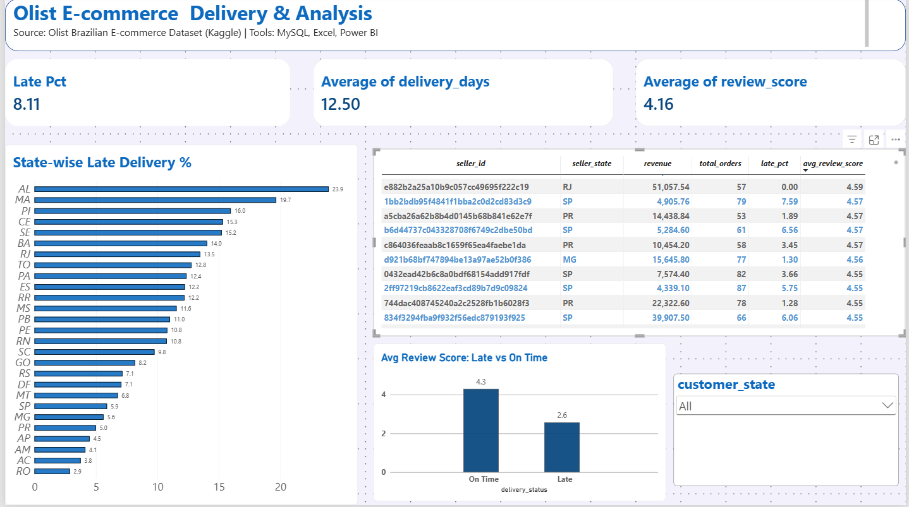

# Olist E-commerce Delivery & Seller Analysis

## What is this project?
A README is the "front page" of a GitHub project. It tells a recruiter in 1 minute what the project is, what tools were used and what was found.

This project analyses delivery performance and seller quality of Olist, a Brazilian e-commerce marketplace, using about 99K orders (2016-2018).

## Business questions
1. How good is delivery, and which states get the most late deliveries?
2. How does late delivery affect customer reviews?
3. Which sellers perform badly (high late %, low rating)?

## Tools
- MySQL: data loading, cleaning, JOINs, aggregation
- Excel: quick chart for state-wise late %
- Power BI: interactive dashboard (DAX measure, slicer, KPI cards)

## Dataset
[Brazilian E-Commerce Public Dataset by Olist (Kaggle)](https://www.kaggle.com/datasets/olistbr/brazilian-ecommerce). Tables used: orders, order_items, customers, sellers, order_reviews.

## Approach
1. Loaded 5 CSV files into MySQL using LOAD DATA LOCAL INFILE.
2. Data checks: no duplicate orders; 8 "delivered" orders had no delivery date and were removed; 0 invalid dates.
3. Analysed only delivered orders (96,470), since other orders have not reached the customer.
4. Built order_delivery (JOIN of orders, customers, reviews) with delivery days and Late / On Time status.
5. Reviews were averaged per order before joining, because some orders have multiple reviews and would create duplicate rows.
6. Built seller_performance using COUNT(DISTINCT order_id) so orders with many items are not counted twice.
7. Built the Power BI dashboard on top of these two tables.

## Key insights
- Overall late delivery is 8.11% (7,826 of 96,470 delivered orders).
- North-east states are worst: AL 23.93%, MA 19.67%, PI 15.97%, about 2 to 3 times the overall rate.
- Late delivery hurts reviews: average score drops from 4.29 (On Time) to 2.52 (Late).
- Some sellers with 50+ orders have a late rate above 25% and low ratings, for example a PR seller at 30.14% late with a 3.07 rating.
- Average delivery time is 12.5 days and average review score is 4.16.

## Recommendations
- Improve logistics (local warehouses or better courier partners) for north-east states.
- Give support or warnings to sellers with a late rate above 20%.
- Set more realistic delivery estimates for far-away states.

## Files
- queries.sql: all SQL (setup, load, cleaning, analysis tables, insight queries)
- olist_dashboard.pbix: Power BI dashboard
- dashboard.png: dashboard screenshot
